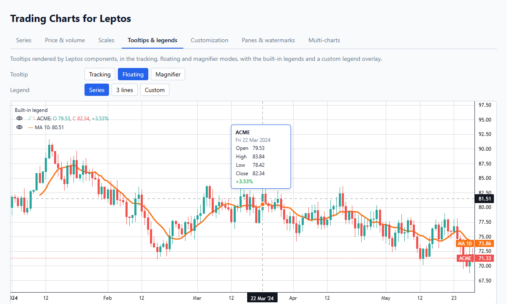

[![Crates.io]](https://crates.io/crates/trading-charts)
[![Docs.rs]](https://docs.rs/trading-charts/)

# Trading-Charts
Rust bindings of [Lightweight Charts] 5.3, the financial charts library of TradingView,
with components for [Leptos] and [Dioxus].

The charts are driven from Rust: options, data, markers, events and formatters are plain Rust types,
and the JS library is bundled in the WebAssembly module, so there is no JS to write nor to load.



## Crates

| Crate                    | Directory                          | Role                                               |
|--------------------------|------------------------------------|----------------------------------------------------|
| `trading-charts`         | [`leptos`](leptos)                 | [Leptos] components.                               |
| `trading-charts-dioxus`  | [`dioxus`](dioxus)                 | [Dioxus] components, for the web renderer.         |
| `trading-charts-core`    | [`core`](core)                     | Framework-agnostic chart handle, data and options. |
| `wasmbind-js-file-macro` | [`wasmbind-macro`](wasmbind-macro) | Macro inlining the JS bundle into the wasm module. |

The adapters re-export the core types, so an application only depends on the adapter of its framework.
The charts need a browser: the Dioxus desktop, mobile and liveview renderers are not supported.

## Features

- **Series**: candlestick, bar, line, area, baseline and histogram series, with all their options,
  several series per chart, whitespace data and per-item colors.
- **Price and volume**: a component drawing prices (candles, bars, line or area) and volumes on the same chart.
- **Scales**: left, right and overlay price scales, price scale modes (normal, logarithmic, percentage, indexed to 100),
  inverted scales, hidden time scale.
- **Panes**: several panes per chart, with stretch factors, heights, moves and swaps.
- **Markers**: built-in buy and sell markers, any shape, position (including at a price) and color,
  and custom marker styles registered under an identifier (`MarkerType::Custom(id)`).
- **Price lines** and **watermarks** (text and image, per pane).
- **Tooltips and legends**: tooltips rendered by framework components (tracking, floating and magnifier modes),
  a built-in legend (series rows or "3 lines" layout) and overlays for custom legends.
- **Crosshair**: all the crosshair modes, programmatic moves, and synchronization of the crosshair
  and of the visible range between charts.
- **Events**: crosshair moves, clicks, double clicks, visible range and size changes, as Rust callbacks.
- **Time**: time zones (the time scale follows the local days and hours), visible range presets
  (last months, year to date, last bars...) and resampling of data to larger intervals.
- **Customization**: locale, date formats, price and time formatters, fonts (including web fonts).
  The formatters are predefined behaviors described by Rust enums, or Rust closures registered under a name.
- **Screenshots**: as data URLs (PNG, JPEG, WebP), canvases or downloaded files.

## Quick start

With Leptos:

```rust
use leptos::prelude::*;
use trading_charts::{
    chart::Chart,
    data::{options::ChartOptions, Candlestick, Marker, UTCTimestamp},
    series::candlesticks::CandleStickSeries,
};

#[component]
fn App() -> impl IntoView {
    let time = |day: &str| day.parse::<UTCTimestamp>().unwrap();
    let data = vec![
        Candlestick::new(time("2024-01-02"), 10.0, 11.5, 9.5, 11.0),
        Candlestick::new(time("2024-01-03"), 11.0, 12.0, 10.5, 10.8),
    ];
    let markers = vec![Marker::buy(time("2024-01-02"))];

    view! {
        <Chart options=ChartOptions::new().with_auto_size(true) style="height:400px">
            <CandleStickSeries data=data markers=markers />
        </Chart>
    }
}
```

With Dioxus:

```rust
use dioxus::prelude::*;
use trading_charts_dioxus::{
    chart::Chart,
    data::{options::ChartOptions, Candlestick, UTCTimestamp},
    series::candlesticks::CandleStickSeries,
};

#[component]
fn App() -> Element {
    let time = |day: &str| day.parse::<UTCTimestamp>().unwrap();
    let data = vec![
        Candlestick::new(time("2024-01-02"), 10.0, 11.5, 9.5, 11.0),
        Candlestick::new(time("2024-01-03"), 11.0, 12.0, 10.5, 10.8),
    ];

    rsx! {
        Chart {
            options: ChartOptions::new().with_auto_size(true),
            style: "height:400px",
            CandleStickSeries { data }
        }
    }
}
```

The crate READMEs describe the components and the core API in more detail.

## Examples

[`examples/leptos`](examples/leptos) and [`examples/dioxus`](examples/dioxus) are the same gallery of demos,
one tab per group of features, written with each adapter.
Serve them with `cargo make serve-example` and `cargo make serve-example-dioxus`.

## Development

The JS binding (`core/bindings`) is bundled by the build script of the `trading-charts-core` crate,
which requires [Node.js](https://nodejs.org/) and npm.

The workspace tasks are run with [cargo-make](https://github.com/sagiegurari/cargo-make)
(`cargo install cargo-make`).
Run `cargo make` from the workspace root to list them, for instance:

- `cargo make fmt`: format the workspace (requires the nightly toolchain).
- `cargo make check-wasm`: check the workspace on the `wasm32-unknown-unknown` target.
- `cargo make clippy`: lint the workspace with clippy on the `wasm32-unknown-unknown` target.
- `cargo make test`: run the tests of the core crate.
- `cargo make serve-example` / `cargo make serve-example-dioxus`: serve an example with Trunk.
- `cargo make verify`: format, check, lint, test and build both examples.

## Updating Lightweight Charts

Run `cargo make update-lightweight-charts` from the workspace root to refresh the binding package
to the latest npm release, and update its lockfile.

Run `cargo make update-lightweight-charts -e LIGHTWEIGHT_CHARTS_VERSION=5.3.0`
to pin a specific upstream version instead.

## License

MIT. Lightweight Charts™ is a library of TradingView, under the Apache 2.0 license:
its [attribution requirements](https://github.com/tradingview/lightweight-charts#license-and-attribution)
apply to the applications using it, the attribution logo shown by default being one way to fulfill them.

[Crates.io]: https://img.shields.io/crates/v/trading-charts?style=for-the-badge
[Docs.rs]: https://img.shields.io/docsrs/trading-charts?style=for-the-badge
[Lightweight Charts]: https://github.com/tradingview/lightweight-charts
[Leptos]: https://leptos.dev/
[Dioxus]: https://dioxuslabs.com/
